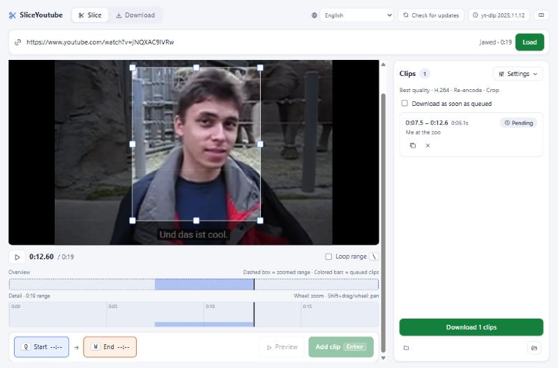

<div align="center">


# SliceYoutube

[English](README.md) · **한국어**

### 2시간짜리 영상 말고, 필요한 10초만.

[](https://github.com/nopushfriday/slice-youtube/releases/latest) [](https://github.com/nopushfriday/slice-youtube/releases/latest) [](https://github.com/nopushfriday/slice-youtube/releases/latest)

[](https://github.com/nopushfriday/slice-youtube/releases)
[](https://github.com/nopushfriday/slice-youtube/releases)
[](https://github.com/nopushfriday/slice-youtube/actions/workflows/ci.yml)

[](LICENSE)


[설치](#설치) · [사용법](#사용법) · [단축키](#단축키) · [빌드](#빌드)



<sub>영상을 보며 Q / W 로 구간을 정하고 Enter 로 담으면, 그 구간만 받습니다.</sub>

</div>

## 주요 기능

- ✂️ **구간만 다운로드** — 전체가 아니라 `yt-dlp --download-sections`로 지정한 구간만 수신
- 🎯 **정밀한 구간 지정** — 영상을 보며 `Q` / `W` 또는 타임라인 핸들 드래그, 프레임 단위 이동
- 📋 **큐** — 한 영상에서 여러 구간을 담아 순서대로 다운로드, 담자마자 바로 받기 옵션
- 🎞️ **코덱 선택** — 자동 / H.264 / VP9 / AV1 (영상이 제공하지 않으면 받은 뒤 인코딩), 하드웨어 인코딩 선택 가능
- 🎵 **오디오만(mp3)** 추출과 **화면 자르기**
- ⬇️ **일반 다운로드 탭** — 전체 영상·재생목록, 병합/원본, 오디오 형식·비트레이트 옵션
- 🌐 **14개 UI 언어** — 시스템 언어 자동 선택, 앱에서 변경 가능

## 설치

[Releases](https://github.com/nopushfriday/slice-youtube/releases)에서 받습니다.

- `slice-youtube_<버전>_x64-setup.exe` — 설치 파일
- `slice-youtube-<버전>-portable-x64.zip` — 압축만 풀면 실행되는 포터블 버전
- `slice-youtube_<버전>_amd64.AppImage` — Linux (x86_64)
- `slice-youtube_<버전>_aarch64.dmg` — macOS (Apple Silicon)

## 사용법

1. 영상 URL을 입력해 불러옵니다.
2. 재생하면서 `Q`로 시작, `W`로 끝 지점을 지정합니다. (타임라인 핸들을 끌어도 됩니다)
3. `Enter`로 큐에 추가하고, 필요한 만큼 반복한 뒤 다운로드를 시작합니다.

### 단축키

| 키 | 동작 |
|---|---|
| `Q` / `W` | 시작 / 끝 지점 지정 |
| `Space` | 재생 · 일시정지 |
| `←` `→` | 5초 이동 (`Shift` 1초) |
| `,` `.` | 1프레임 이동 |
| `\` | 구간 반복 |
| `Enter` | 큐에 추가 |

타임라인 핸들을 끌면 영상 위치가 따라가며, `Shift`를 누르고 끌면 미세 조절됩니다.

### 알려진 사항

- macOS 빌드는 Apple 개발자 서명/공증 없이 배포되므로, 처음 실행 시 "확인되지 않은 개발자" 경고가 뜹니다. 시스템 설정 → 개인정보 보호 및 보안에서 "그래도 열기"를 누르거나, 터미널에서 `xattr -dr com.apple.quarantine /Applications/slice-youtube.app` 을 실행하세요.
- AV1 인코딩(영상이 AV1을 제공하지 않을 때의 폴백)은 libaom을 쓰므로 H.264/VP9보다 느립니다.

## 빌드

필요: Node.js, pnpm, Rust

### Windows (PowerShell)

```powershell
pnpm install
pwsh scripts/fetch-binaries.ps1      # yt-dlp, deno 받기
pwsh scripts/build-ffmpeg-win.ps1    # ffmpeg 9.0.2 빌드
pnpm tauri build                     # 설치 파일 (NSIS)
pwsh scripts/make-portable.ps1       # 포터블 zip
pwsh scripts/verify-build.ps1        # 결과물 검증 (선택)
```

- 설치 파일: `src-tauri/target/release/bundle/nsis/slice-youtube_<버전>_x64-setup.exe`
- 포터블 zip: `dist/slice-youtube-<버전>-portable-x64.zip`

### Linux (Debian/Ubuntu 계열)

```bash
pnpm install
pwsh scripts/fetch-binaries.ps1      # yt-dlp, deno 받기
bash scripts/build-ffmpeg-linux.sh   # ffmpeg 9.0.2 빌드 (sudo 필요)
pnpm tauri build                     # AppImage
bash scripts/verify-build-linux.sh   # 결과물 검증 (선택)
```

- AppImage: `src-tauri/target/release/bundle/appimage/slice-youtube_<버전>_amd64.AppImage`

### macOS (Apple Silicon, macOS 14 이상)

```bash
pnpm install
pwsh scripts/fetch-binaries.ps1      # yt-dlp, deno 받기 (PowerShell 7 필요: brew install powershell)
bash scripts/build-ffmpeg-macos.sh   # ffmpeg 9.0.2 빌드 (Homebrew 필요)
pnpm tauri build                     # .app / .dmg
bash scripts/verify-build-macos.sh   # 결과물 검증 (선택)
```

- DMG: `src-tauri/target/release/bundle/dmg/slice-youtube_<버전>_aarch64.dmg`

### 참고

- 버전은 `src-tauri/tauri.conf.json`의 `version`을 따릅니다. 배포할 때는 `package.json`, `src-tauri/Cargo.toml`의 `version`도 같이 올립니다.
- sidecar 바이너리(yt-dlp, deno, ffmpeg)는 git에 없으므로 `tauri dev`/`tauri build` 전에 위 준비 단계가 필요합니다. 개발 실행만 할 때는 `pnpm tauri build` 대신 `pnpm tauri dev`를 씁니다.
- Linux는 Tauri [시스템 의존 패키지](https://v2.tauri.app/start/prerequisites/#linux)도 필요합니다.

## 서드파티

앱은 아래 프로그램을 별도 실행 파일(sidecar)로 함께 배포하며, 링크하지 않고 프로세스로 실행합니다. 바이너리는 git에 포함하지 않습니다.

| 바이너리 | 라이선스 | 소스 |
|---|---|---|
| yt-dlp | Unlicense | [yt-dlp/yt-dlp](https://github.com/yt-dlp/yt-dlp) |
| deno | MIT | [denoland/deno](https://github.com/denoland/deno) |
| ffmpeg (경량 컴파일 버전) | LGPL 2.1+ | [FFmpeg/FFmpeg `n9.0.2`](https://github.com/FFmpeg/FFmpeg/tree/n9.0.2) |

## 라이선스

[MIT](LICENSE) © 2026 nopushfriday
