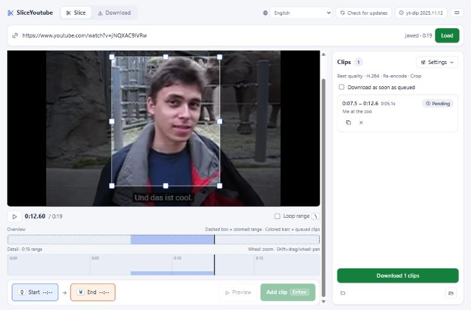

<div align="center">


# SliceYoutube

**English** · [한국어](README.ko.md)

### Grab just the 10 seconds you want — not the 2-hour video.

[](https://github.com/nopushfriday/slice-youtube/releases/latest) [](https://github.com/nopushfriday/slice-youtube/releases/latest) [](https://github.com/nopushfriday/slice-youtube/releases/latest)

[](https://github.com/nopushfriday/slice-youtube/releases)
[](https://github.com/nopushfriday/slice-youtube/releases)
[](https://github.com/nopushfriday/slice-youtube/actions/workflows/ci.yml)

[](LICENSE)


[Install](#install) · [Usage](#usage) · [Shortcuts](#shortcuts) · [Build](#build)



<sub>Watch, set the range with Q / W, press Enter to queue it — only that range is downloaded.</sub>

</div>

## Features

- ✂️ **Range-only download** — fetches just the selected part with `yt-dlp --download-sections`, not the whole video
- 🎯 **Precise range picking** — watch the video, press `Q` / `W` or drag the timeline handles, step frame by frame
- 📋 **Queue** — add several ranges from one video and download them in order, or auto-download as soon as a range is queued
- 🎞️ **Codec choice** — Auto / H.264 / VP9 / AV1 (re-encoded after download if the video doesn't offer it), with optional hardware encoding
- 🎵 **Audio-only (mp3)** and **picture crop**
- ⬇️ **Plain download tab** — full videos and playlists with merge / original, audio format and bitrate options
- 🌐 **14 UI languages** — picked from your system language, changeable in the app

## Install

Download from [Releases](https://github.com/nopushfriday/slice-youtube/releases).

- `slice-youtube_<version>_x64-setup.exe` — installer
- `slice-youtube-<version>-portable-x64.zip` — portable build, just unzip and run
- `slice-youtube_<version>_amd64.AppImage` — Linux (x86_64)
- `slice-youtube_<version>_aarch64.dmg` — macOS (Apple Silicon)

## Usage

1. Enter a video URL and load it.
2. While playing, press `Q` to set the start and `W` to set the end. (You can also drag the timeline handles.)
3. Press `Enter` to add it to the queue, repeat as needed, then start the download.

### Shortcuts

| Key | Action |
|---|---|
| `Q` / `W` | Set start / end point |
| `Space` | Play / pause |
| `←` `→` | Seek 5 s (`Shift`: 1 s) |
| `,` `.` | Step one frame |
| `\` | Loop the range |
| `Enter` | Add to queue |

Dragging a timeline handle moves the video position with it; hold `Shift` while dragging for fine adjustment.

### Known issues

- The macOS build is distributed without Apple developer signing/notarization, so the first launch shows an "unidentified developer" warning. Click "Open Anyway" in System Settings → Privacy & Security, or run `xattr -dr com.apple.quarantine /Applications/slice-youtube.app` in a terminal.
- AV1 encoding (the fallback when a video doesn't offer AV1) uses libaom, so it is slower than H.264/VP9.

## Build

Requires: Node.js, pnpm, Rust

### Windows (PowerShell)

```powershell
pnpm install
pwsh scripts/fetch-binaries.ps1      # fetch yt-dlp, deno
pwsh scripts/build-ffmpeg-win.ps1    # build ffmpeg 9.0.2
pnpm tauri build                     # installer (NSIS)
pwsh scripts/make-portable.ps1       # portable zip
pwsh scripts/verify-build.ps1        # verify the output (optional)
```

- Installer: `src-tauri/target/release/bundle/nsis/slice-youtube_<version>_x64-setup.exe`
- Portable zip: `dist/slice-youtube-<version>-portable-x64.zip`

### Linux (Debian/Ubuntu)

```bash
pnpm install
pwsh scripts/fetch-binaries.ps1      # fetch yt-dlp, deno
bash scripts/build-ffmpeg-linux.sh   # build ffmpeg 9.0.2 (needs sudo)
pnpm tauri build                     # AppImage
bash scripts/verify-build-linux.sh   # verify the output (optional)
```

- AppImage: `src-tauri/target/release/bundle/appimage/slice-youtube_<version>_amd64.AppImage`

### macOS (Apple Silicon, macOS 14+)

```bash
pnpm install
pwsh scripts/fetch-binaries.ps1      # fetch yt-dlp, deno (needs PowerShell 7: brew install powershell)
bash scripts/build-ffmpeg-macos.sh   # build ffmpeg 9.0.2 (needs Homebrew)
pnpm tauri build                     # .app / .dmg
bash scripts/verify-build-macos.sh   # verify the output (optional)
```

- DMG: `src-tauri/target/release/bundle/dmg/slice-youtube_<version>_aarch64.dmg`

### Notes

- The version follows `version` in `src-tauri/tauri.conf.json`. When releasing, bump `version` in `package.json` and `src-tauri/Cargo.toml` too.
- The sidecar binaries (yt-dlp, deno, ffmpeg) are not in git, so the steps above are needed before `tauri dev` / `tauri build`. For development only, use `pnpm tauri dev` instead of `pnpm tauri build`.
- Linux also needs Tauri's [system dependencies](https://v2.tauri.app/start/prerequisites/#linux).

## Third-party

The app ships the programs below as separate executables (sidecars) and runs them as processes rather than linking them. The binaries are not included in git.

| Binary | License | Source |
|---|---|---|
| yt-dlp | Unlicense | [yt-dlp/yt-dlp](https://github.com/yt-dlp/yt-dlp) |
| deno | MIT | [denoland/deno](https://github.com/denoland/deno) |
| ffmpeg | LGPL 2.1+ | [FFmpeg/FFmpeg `n9.0.2`](https://github.com/FFmpeg/FFmpeg/tree/n9.0.2) |

## License

[MIT](LICENSE) © 2026 nopushfriday
